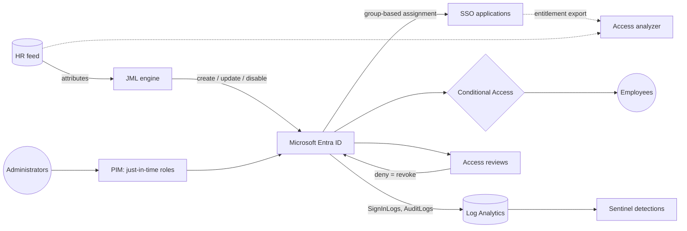

# Meridian IAM Lab

[](https://github.com/wmouton/meridian-iam-lab/actions/workflows/ci.yml)


A workforce identity and access management lab for a made-up 200-person company. I built it to see how the pieces fit together and where they
break: HR-driven joiner/mover/leaver automation, role-based access with segregation-of-duties rules, MFA and Conditional Access as code,
just-in-time privileged access, access recertification and identity detections. Design docs, runbooks and a control mapping sit alongside the code.

The Python tooling runs offline against synthetic data. The PowerShell scripts, policies and KQL rules deploy the same design to a Microsoft
Entra ID tenant through Microsoft Graph and Sentinel. CI exercises the offline half end to end; the PowerShell, policies and KQL only get static
checks there, so test them in a lab tenant before you trust them.

## Contents

- [Features](#features)
- [Architecture](#architecture)
- [Quick start](#quick-start)
- [Usage](#usage)
- [Data model](#data-model)
- [Results](#results)
- [Repository layout](#repository-layout)
- [Testing and validation](#testing-and-validation)
- [Requirements and licensing](#requirements-and-licensing)
- [Development](#development)
- [Documentation](#documentation)
- [Security](#security)
- [License](#license)

## Features

| Area | Capability | Implementation |
|---|---|---|
| Identity lifecycle | HR feed reconciliation: pre-boarding, enable on start date, mover access replacement, leaver disable with session revocation, 30-day retention, orphan and rehire flags | `jml_engine.py`, `Invoke-JmlSync.ps1` |
| Safety controls | Row quarantine, duplicate-ID handling, 5% disable circuit breaker, truncated-feed guard, idempotent runs, atomic state writes, audit log | `jml_engine.py` |
| RBAC and SoD | 23 business roles, birthright access, 6 segregation-of-duties rules enforced at design, provisioning and review time | `data/role_catalog.json`, `data/sod_rules.json` |
| Authentication | 8 Conditional Access policies as code (MFA, legacy-auth block, phishing-resistant admin MFA, risk-based, location), report-only rollout | `policies/conditional-access/`, `New-ConditionalAccessPolicies.ps1` |
| Access reviews | Analyzer for orphans, leavers, dormant accounts, privilege creep, SoD violations and MFA gaps; Entra campaign template with default-deny | `access_review_analyzer.py`, `Start-AccessReviewCampaign.ps1` |
| Privileged access | PIM eligibility assignment, standing-privilege audit, break-glass design | `New-PimEligibleAssignment.ps1`, `Audit-PrivilegedRoles.ps1` |
| Hygiene audits | Stale-account and MFA-gap reports from Microsoft Graph | `Audit-StaleAccounts.ps1`, `Audit-MfaGaps.ps1` |
| Detection | 8 Sentinel KQL analytics rules mapped to MITRE ATT&CK, with a test plan | `detections/` |
| Governance | IAM standard, 20-control mapping to NIST 800-53 / ISO 27001 / SOC 2 / SOX ITGC, 8 runbooks | `docs/` |

## Architecture



Principles: HR is the source of truth, access is role-based and least privilege, privileged access is just in time, MFA applies everywhere
(phishing-resistant for admins), access is recertified on a schedule, automation fails safe, and identity events are logged and watched.
Full design: [docs/01-architecture.md](docs/01-architecture.md).

## Quick start

Offline (no cloud account required). Requires [uv](https://docs.astral.sh/uv/).

```bash
git clone https://github.com/wmouton/meridian-iam-lab.git && cd meridian-iam-lab
uv sync            # creates .venv from uv.lock (downloads Python if needed)
uv run pytest      # 30 tests
make demo          # day 0 -> day 30 -> access review -> remediation -> re-review (output in ./out)
```

Microsoft Entra deployment is described step by step in [docs/00-lab-setup.md](docs/00-lab-setup.md).

## Usage

### Command-line tools

| Command | Purpose |
|---|---|
| `uv run iam-generate-data` | Regenerate the deterministic HR feeds, access export and answer key in `data/` |
| `uv run iam-jml` | Process an HR feed against a directory snapshot (dry run by default) |
| `uv run iam-access-review` | Analyze an entitlement export and write findings, summary and report |
| `uv run iam-remediate` | Apply recommended remediation to a copy of the export (before/after comparison) |

### Lifecycle processing

```bash
# Day 0: provision from the baseline HR feed
uv run iam-jml --hr-feed data/hr_feed_day0.csv --as-of 2026-09-30 --apply

# Day 30: preview, then commit joiners, movers and leavers
uv run iam-jml --hr-feed data/hr_feed_day30.csv --as-of 2026-10-30
uv run iam-jml --hr-feed data/hr_feed_day30.csv --as-of 2026-10-30 --apply
```

| Option | Description |
|---|---|
| `--hr-feed` | HR CSV (required) |
| `--directory` | Directory snapshot (default `state/directory.json`) |
| `--as-of` | Processing date, `YYYY-MM-DD` (default today) |
| `--apply` | Commit changes; omit for a dry run |
| `--force` | Override the circuit breaker |
| `--out` | Output directory (default `out/`) |

Outputs: `jml_actions.json`, `jml_summary.json`, `quarantine.csv`, `audit.jsonl`. Exit codes: `0` success, `2` circuit breaker tripped, `3` invalid feed.

### Access review

```bash
uv run iam-access-review                  # -> out/findings.csv, findings_summary.json, access_review_report.md
uv run iam-remediate                      # -> out/app_access_export_remediated.csv
uv run iam-access-review --access out/app_access_export_remediated.csv --out out/after
```

`findings.csv` doubles as the reviewer worksheet (blank `decision`, `reviewer`, `decision_date` columns). Finding types are listed in
[docs/05-access-reviews.md](docs/05-access-reviews.md).

### Microsoft Entra (PowerShell 7 + Microsoft Graph)

All scripts are in `scripts/powershell/`, request only the Graph scopes they need (listed in each script header), and honour `-WhatIf`.

| Script | Purpose |
|---|---|
| `New-LabGroups.ps1` | Create the role, department, application and platform groups |
| `Invoke-JmlSync.ps1` | HR feed to Entra ID: joiners, movers, leavers, orphan report |
| `New-ConditionalAccessPolicies.ps1` | Deploy `policies/conditional-access/*.json`, report-only by default |
| `New-PimEligibleAssignment.ps1` | Make a user eligible for a directory role through PIM |
| `Start-AccessReviewCampaign.ps1` | Create a quarterly access review from a template |
| `Audit-PrivilegedRoles.ps1` | List role assignments and flag standing privilege |
| `Audit-StaleAccounts.ps1` | Enabled accounts with no sign-in for N days |
| `Audit-MfaGaps.ps1` | Users without MFA; admins without phishing-resistant methods |

```powershell
Install-Module Microsoft.Graph -Scope CurrentUser
./scripts/powershell/Invoke-JmlSync.ps1 -HrFeed ./data/hr_feed_day0.csv -WhatIf
```

### Detections

Eight KQL rules in `detections/kql/` (MFA fatigue, impossible travel, privileged role assignment, dormant account reactivation, legacy
authentication, disabled-account sign-ins, Conditional Access tampering, break-glass use). Setup, MITRE mapping and a test plan are in
[detections/README.md](detections/README.md).

## Data model

| File | Description |
|---|---|
| `data/role_catalog.json` | Source of truth: job titles, departments, business roles, entitlements, privileged entitlements, birthright access |
| `data/sod_rules.json` | Segregation-of-duties rules with severity and rationale |
| `data/role_matrix.csv` | Generated role-to-entitlement matrix |
| `data/hr_feed_day0.csv` | Baseline HR feed: 200 active employees and 9 historical leavers |
| `data/hr_feed_day30.csv` | Thirty days later: 6 joiners, 8 movers, 5 leavers (one scheduled), 3 invalid rows |
| `data/app_access_export.csv` | Application entitlement export seeded with known defects |
| `data/ground_truth.json` | Answer key used by the tests |

HR feed columns: `employee_id, first_name, last_name, upn, department, job_title, manager_id, location, employment_type, status, start_date, end_date`.
All data is deterministic (fixed seed) and fictional. To use a real tenant domain, change `company.domain` in the role catalog and run `uv run iam-generate-data`.

## Results

Reproducible with `make demo`; sample output is in [`examples/sample-output/`](examples/sample-output). The answer key comes from the same generator that
seeds the defects, so these numbers show the tooling does what I built it to do. They say nothing about how it copes with a messy real export.

| Measure | Result |
|---|---|
| Accounts provisioned from HR | 200 of 200; a second run produces 0 actions |
| Day-30 changes | 6 joiners (3 enabled, 3 pre-boarded), 8 movers, 4 leavers disabled, 4 deleted after retention |
| Invalid HR rows | 3 quarantined, no action taken on them |
| SoD conflicts prevented on role change | 2 (SOD-001, SOD-003) |
| Mass-termination and truncated-feed tests | Circuit breaker aborts with no changes |
| Seeded defects detected | 14 orphans, 9 leavers (3 with post-termination logins), 23 dormant, 11 SoD, 28 excess entitlements, 5 privileged accounts without MFA: all found, 0 false positives |
| Open findings before / after remediation | 93 / 0 |

Details and KPI definitions: [docs/10-results.md](docs/10-results.md).

## Repository layout

```
data/                 role catalog, SoD rules, generated HR feeds, access export, answer key
src/meridian_iam/     jml_engine, access_review_analyzer, simulate_remediation, generate_hr_data, iamlib
scripts/powershell/   Microsoft Graph automation and audit scripts
policies/             Conditional Access policy JSON (CA001-CA008), access-review template
detections/           Sentinel KQL analytics rules (DET-001..008) and README
docs/                 architecture, lifecycle, RBAC, authentication, reviews, PAM, logging, controls, runbooks, standard, roadmap
tests/                pytest suite: catalog integrity, lifecycle behaviour, detection accuracy
examples/             sample outputs from a clean run
.github/workflows/    CI
```

## Testing and validation

| Component | Coverage |
|---|---|
| Python tooling | 30 pytest tests: role-catalog integrity (no SoD conflicts in any role), lifecycle behaviour (idempotency, pre-boarding, retention, drift, orphans, circuit breaker, truncated feed, malformed input), and analyzer accuracy against the seeded answer key including remediation to zero findings |
| CI | ruff lint and format, pytest on Python 3.10 / 3.12 / 3.13, the full demo run, lockfile check; PSScriptAnalyzer and JSON validation for the PowerShell and policy files |
| PowerShell | Syntax-checked with PowerShell 7.4; group naming verified identical to the Python implementation; all state-changing operations support `-WhatIf` |
| Conditional Access | Deployed in report-only mode by default; enforcement requires two break-glass accounts and is blocked otherwise |
| KQL detections | Validate each rule against your workspace data and tune thresholds before enabling alerting (see [detections/README.md](detections/README.md)) |

## Requirements and licensing

| Component | Requirement |
|---|---|
| Python tooling | Python 3.10+ and [uv](https://docs.astral.sh/uv/); no runtime dependencies |
| PowerShell scripts | PowerShell 7.2+, `Microsoft.Graph` module |
| Users, groups, SSO | Microsoft Entra ID Free |
| Conditional Access, group-based app assignment, sign-in log export | Entra ID P1 |
| PIM, risk-based policies (CA004/CA005), access reviews | Entra ID P2 or ID Governance (a 30-day trial is sufficient) |
| Detections | Azure subscription with Log Analytics and Microsoft Sentinel |

## Development

| Task | Command |
|---|---|
| Install locked environment | `uv sync` (or `make sync`) |
| Run tests | `uv run pytest` (or `make test`) |
| Lint and format check | `make lint` |
| Auto-fix | `make format` |
| Add a dev dependency | `uv add --dev <package>` |
| Upgrade the lockfile | `uv lock --upgrade` |

The runtime uses only the standard library; `pytest` and `ruff` are in the `dev` dependency group. `uv.lock` is committed and CI verifies it.
The package is installed in editable mode because it reads the data files from the repository root.

Issues and PRs are fine. [Open an issue](https://github.com/wmouton/meridian-iam-lab/issues) first for anything bigger than a fix, keep `make lint test` green, and add a test for new behaviour.

## Documentation

| Document | Topic |
|---|---|
| [00 Lab setup](docs/00-lab-setup.md) | Offline and Entra tenant setup, licensing, build order, troubleshooting |
| [01 Architecture](docs/01-architecture.md) | Scope, principles, components, design decisions, risks |
| [02 Identity lifecycle](docs/02-identity-lifecycle.md) | Joiner/mover/leaver rules, state model, safety controls |
| [03 RBAC model](docs/03-rbac-model.md) | Roles, entitlements, SoD rules, exception process |
| [04 Authentication](docs/04-authentication-and-conditional-access.md) | MFA standard, Conditional Access baseline, rollout |
| [05 Access reviews](docs/05-access-reviews.md) | Review calendar, procedure, analyzer findings |
| [06 Privileged access](docs/06-privileged-access.md) | PIM configuration, break-glass, audits |
| [07 Logging and detection](docs/07-logging-and-detection.md) | Log sources, detection catalogue, response |
| [08 Control mapping](docs/08-control-mapping.md) | NIST 800-53, ISO 27001:2022, SOC 2, SOX ITGC |
| [09 Runbooks](docs/09-runbooks.md) | Eight operational procedures |
| [10 Results](docs/10-results.md) | Measured results and KPI definitions |
| [11 Roadmap](docs/11-roadmap.md) | Production considerations and limitations |
| [IAM standard](docs/policy-iam-standard.md) | Policy statements |

## Security

See [SECURITY.md](SECURITY.md). The repository contains no credentials. The scripts are meant for a lab or developer tenant; read them and run with
`-WhatIf` before using them anywhere else.

## License

MIT. See [LICENSE](LICENSE).
