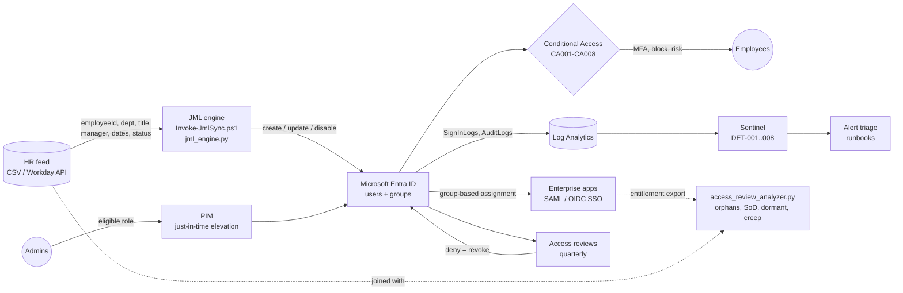

# 01 - Architecture and Design

**Document owner:** IAM Analyst | **Status:** Approved (lab) | **Review cycle:** annual

## 1. Purpose and scope

Meridian Financial Services is a fictional 200-person company (HR 12, Finance 28, IT 35, Sales 70, Operations 40, Legal 8, Executive 7).
This design defines how workforce identities are created, authenticated, authorised, reviewed and monitored.

In scope: employees and contractors, cloud SSO, privileged administration, access recertification, identity logging.
Out of scope: customer identity (CIAM), workload identities beyond owner/ownerless inventory, on-premises AD (cloud-only lab).

## 2. Design principles

| # | Principle | What it means here |
|---|---|---|
| P1 | HR is the source of truth | Identity lifecycle is driven by HR attributes, never by tickets or ad-hoc admin work. |
| P2 | Role-based, least privilege | Access is granted through business roles; direct user assignments are exceptions with an expiry. |
| P3 | No standing privilege | Administrators are eligible, elevate just in time with MFA, and use separate admin accounts. |
| P4 | Strong authentication everywhere | MFA for all, phishing-resistant for admins, legacy protocols blocked. |
| P5 | Prove it periodically | Quarterly recertification for sensitive access, default-deny on no response. |
| P6 | Fail safe | Bad data produces no action; destructive actions have a circuit breaker. |
| P7 | Everything is logged and watched | Identity events go to a SIEM with detections mapped to MITRE ATT&CK. |

## 3. Logical architecture

## 4. Components

| Layer | Lab implementation | Production analogue |
|---|---|---|
| Authoritative source | `hr_feed_*.csv` | Workday / SAP SuccessFactors / BambooHR via inbound provisioning or API-driven provisioning |
| Directory + IdP | Microsoft Entra ID | Entra ID, Okta Universal Directory |
| Lifecycle automation | `Invoke-JmlSync.ps1` (Graph) | Entra HR-driven provisioning + Lifecycle Workflows, Okta Lifecycle Mgmt, SailPoint |
| Authorisation model | Role -> group -> app role | Same, plus Entra Entitlement Management access packages |
| Authentication | Authenticator, FIDO2, passkeys + Conditional Access | Same |
| Privileged access | Entra PIM + separate admin accounts | PIM, CyberArk, BeyondTrust, HashiCorp Vault for secrets |
| Governance | Entra Access Reviews + analyzer | Entra ID Governance, SailPoint IdentityIQ/ISC, Saviynt |
| Monitoring | Sentinel analytics rules | Sentinel, Splunk ES, Elastic Security |

## 5. Identity types and naming

| Type | Pattern | Lifecycle owner | Notes |
|---|---|---|---|
| Employee / contractor | `first.last@domain`, `employeeId = Exxxxx` | HR | Contractors must have an end date. |
| Admin | `adm-first.last@domain`, cloud-only | IAM | Separate from the daily account; no mailbox, no licence beyond what PIM requires. |
| Break-glass | `bg1@`, `bg2@` | CISO | 2 accounts, FIDO2, excluded from CA, alerted on use (DET-008). |
| Service | `svc-<app>-<purpose>` | Named owner | Must have an owner; reviewed quarterly; prefer managed identities. |

Group naming (identical in PowerShell and Python): `grp-bir-all-staff`, `grp-dept-<dept>`, `grp-role-<business-role>`, `grp-app-<app>-<role>`, `grp-iam-*` (platform-controlled).

## 6. Key design decisions

| Decision | Alternatives considered | Rationale |
|---|---|---|
| Match users on `employeeId`, not UPN/name | UPN match | UPNs change (marriage, rename); `employeeId` is immutable and HR-owned. |
| Create accounts disabled 7 days before start | Create on day 1 | Allows equipment/group readiness; day-1 enablement is a flag flip, not a provisioning dependency. |
| Retain disabled leavers 30 days, then delete | Immediate delete / indefinite retention | Covers mailbox/data hand-over and rehire corrections; limits orphan accumulation. |
| Mover = remove old-role access, then add new | Additive only | Additive movers are a common source of privilege creep and SoD violations (the day-30 run prevented 2; see results). |
| Assigned-membership role groups managed by the engine | Dynamic groups on `jobTitle` | Dynamic groups would hide the SoD and exception logic, and can't express pre-boarding. Listed in the roadmap as a variant. |
| Report-only first for Conditional Access | Enforce immediately | Avoids lockouts; impact is measured in sign-in logs before enforcement. |
| Orphans are *flagged*, never auto-deleted | Auto-delete | Deleting an account that turns out to be a service dependency is an outage; a human decides. |

## 7. Risks and assumptions

| Risk | Mitigation |
|---|---|
| HR feed truncated or corrupt -> mass disable | Circuit breaker (5% disable limit; 10% feed-shrink limit in the Python engine only), quarantine of bad rows |
| Lockout from a bad CA policy | Report-only default, break-glass exclusion, refuse to enforce with < 2 break-glass members |
| Standing admin accounts compromised | PIM eligibility, phishing-resistant MFA (CA003), DET-003 |
| Licence limits (P1/P2 features) | Documented per control; free-tier fallbacks listed in [00-lab-setup.md](00-lab-setup.md) |
| Assumption: HR data is timely | Process requirement: terminations entered in HR before the last working day (see standard) |
