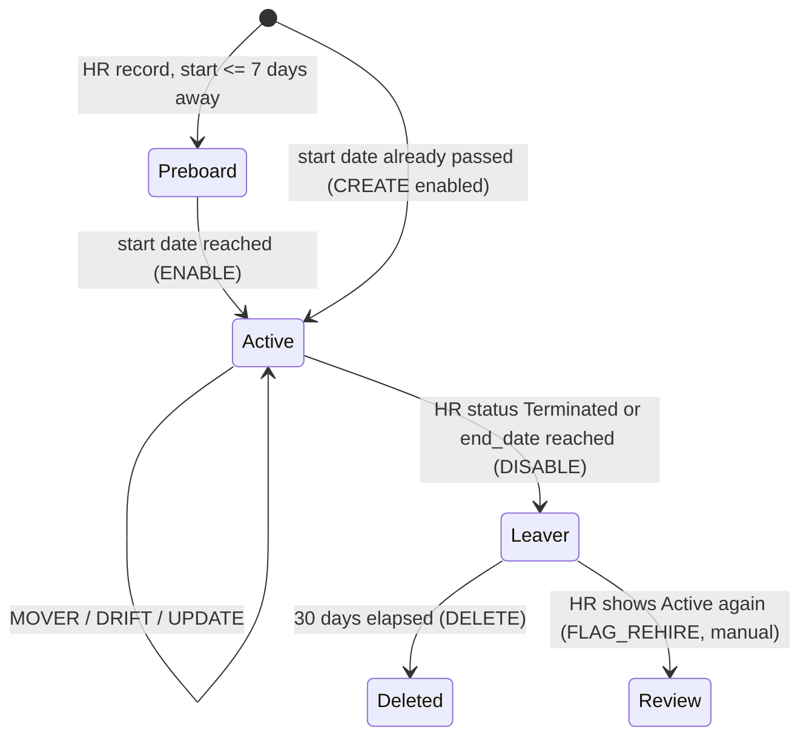

# 02 - Identity Lifecycle: Joiner / Mover / Leaver (JML)

Implementation: [`src/meridian_iam/jml_engine.py`](../src/meridian_iam/jml_engine.py) (tested reference) and
[`scripts/powershell/Invoke-JmlSync.ps1`](../scripts/powershell/Invoke-JmlSync.ps1) (Entra ID via Microsoft Graph).

## 1. State model



## 2. Rules

### Input validation (fail safe)
| Condition | Result |
|---|---|
| Missing required column | Whole run aborted (exit 3) |
| Missing or duplicate `employee_id` | All rows with that id quarantined, no action on that person |
| Invalid date, status, UPN, unknown title, department/title mismatch | Row quarantined, no action |
| Start date more than 7 days away | No account yet |

### Joiner
1. Derive business role and entitlements from `job_title` (role catalog) plus birthright access.
2. Create the account disabled if the start date is in the future (pre-boarding), otherwise enabled.
3. Set `employeeId`, department, title, manager, hire date; add to the role's groups.
4. Credentials: random password that is discarded; user registers MFA using a Temporary Access Pass issued by the service desk after identity verification (runbook RB-01).
5. Start date reached -> `ENABLE`.

### Mover (department or title change)
1. Compute target entitlements for the *new* role.
2. Remove everything not in the new role; add what is missing.
3. Evaluate SoD on `old access + new access`. Any conflict that would have existed is recorded in `sod_conflicts_prevented` and the action is raised to `high` severity for audit.
4. Update manager. Manual drift (access added outside the process) is corrected by `DRIFT` on the next run.

### Leaver (status `Terminated`, or `end_date <= today`)
1. Disable the account and revoke all sign-in sessions and refresh tokens.
2. Remove all managed group memberships and entitlements; stamp the disable date.
3. Retain 30 days, then delete. Any user-owned resources are reassigned to the manager during retention (RB-02).
4. Privileged leavers (any privileged entitlement) are flagged `high`; PIM eligibilities and admin accounts are removed in the same ticket.
5. Scheduled leavers (future end date within 14 days) are reported so the manager can prepare hand-over.

### Orphans and rehires
* Account with no HR record and not a registered service account -> `FLAG_ORPHAN` (never auto-deleted).
* Previously offboarded account whose HR record is Active again -> `FLAG_REHIRE` (human re-enables after verifying the rehire).

## 3. Safety controls

| Control | Default | Why |
|---|---|---|
| Circuit breaker: max disable/delete share of enabled accounts (PowerShell counts disables only) | 5% (applies at >= 20 accounts) | A corrupted feed that marks everyone terminated must not lock out the company |
| Feed truncation guard (Python engine only) | feed < 90% of last run's rows | Partial exports look like mass terminations |
| Dry-run first | default for Python; `-WhatIf` for PowerShell | Reviewable plan before change |
| Idempotency | second run = 0 actions (tested) | Safe to schedule; safe to retry after failure |
| Atomic state write | temp file + replace | No half-written directory snapshot |
| Audit log | append-only JSONL with run id, timestamp, as-of date | Evidence for auditors (AC-2(4), AU-2) |

## 4. Worked example (day 0 -> day 30)

| Run | Feed | Result |
|---|---|---|
| Day 0 (2026-09-30) | 209 rows (200 active, 9 historical leavers) | 200 `CREATE`; 9 leavers correctly get no account |
| Re-run day 0 | same | 0 actions (idempotent) |
| Day 30 (2026-10-30) | 217 rows | 6 `CREATE` (3 enabled, 3 pre-boarded), 8 `MOVER`, 4 `DISABLE`, 3 rows quarantined, 1 scheduled leaver reported |
| Day 30 + 7 | same feed | 3 `ENABLE` (pre-boarded accounts reach start date) |
| Day 30 + 31 | same feed | 4 `DELETE` (retention elapsed) |

Two of the scripted movers show why movers matter. An AP Specialist promoted to Finance Manager and a Payroll Specialist moved to HR Manager
would each have kept a Critical SoD conflict (SOD-001, SOD-003) if their old access had stayed. The engine removed it.

## 5. Running it

```bash
make demo                       # full offline walk-through
uv run iam-jml --hr-feed data/hr_feed_day30.csv --as-of 2026-10-30            # dry run
uv run iam-jml --hr-feed data/hr_feed_day30.csv --as-of 2026-10-30 --apply    # commit
```
```powershell
./scripts/powershell/Invoke-JmlSync.ps1 -HrFeed ./data/hr_feed_day0.csv -WhatIf     # preview against Entra
./scripts/powershell/Invoke-JmlSync.ps1 -HrFeed ./data/hr_feed_day0.csv
```
Outputs land in `out/`: `jml_actions.json`, `jml_summary.json`, `quarantine.csv`, `audit.jsonl`.

## 6. Not built
Inbound provisioning from Workday with attribute mapping and scoping filters; Entra Lifecycle Workflows for leaver tasks
(mailbox conversion, licence removal); manager-approved exceptions via Entitlement Management access packages with expiry;
event-driven (webhook) terminations for sub-hour revocation of high-risk leavers instead of nightly batch.
