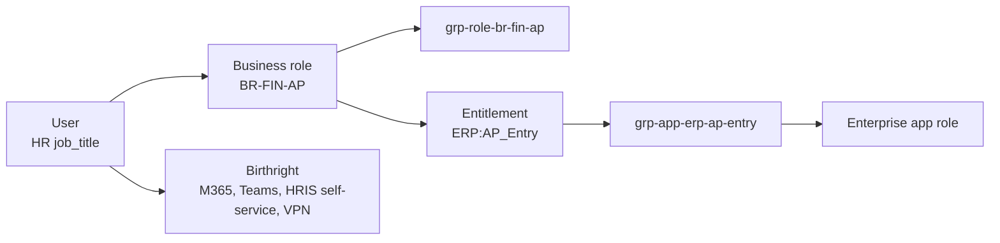

# 03 - Role-Based Access Control (RBAC) Model

Source of truth: [`data/role_catalog.json`](../data/role_catalog.json) | Matrix: [`data/role_matrix.csv`](../data/role_matrix.csv) | SoD: [`data/sod_rules.json`](../data/sod_rules.json)

## 1. Model

* One business role per job title (23 roles). The job title is an HR attribute, so the role is derived, not requested.
* Birthright access (`M365:E3`, `Teams:Member`, `HRIS:Self_Service`, `VPN:Standard`) is identical for everyone.
* Entitlements are `App:Role` pairs; each maps to one `grp-app-*` group that is assigned to the enterprise application.
* Privileged entitlements (`HRIS:HR_Admin`, `INFRA:Admin_Eligible`, `IAM:Helpdesk_Admin`, `ITSM:Admin`, `CRM:Admin`) get extra controls: PIM or dedicated admin account, quarterly review, MFA verification in the analyzer.

## 2. Role matrix (non-birthright entitlements)

| Dept | Business role | Job title | Entitlements | Headcount |
|---|---|---|---|---:|
| HR | BR-HR-GEN | HR Generalist | HRIS:HR_Read | 5 |
| HR | BR-HR-MGR | HR Manager | HRIS:HR_Read, **HRIS:HR_Admin** | 2 |
| HR | BR-HR-REC | Recruiter | ATS:Recruiter | 5 |
| Finance | BR-FIN-ACCT | Accountant | ERP:GL_Post | 10 |
| Finance | BR-FIN-AP | AP Specialist | ERP:AP_Entry | 9 |
| Finance | BR-FIN-PAY | Payroll Specialist | ERP:Payroll_Run | 4 |
| Finance | BR-FIN-MGR | Finance Manager | ERP:AP_Approve, ERP:GL_Read | 3 |
| Finance | BR-FIN-CTRL | Controller | ERP:AP_Approve, ERP:GL_Read, ERP:Period_Close | 2 |
| IT | BR-IT-HELP | Helpdesk Analyst | ITSM:Agent | 14 |
| IT | BR-IT-SYSADM | Systems Administrator | ITSM:Agent, **INFRA:Admin_Eligible** | 9 |
| IT | BR-IT-IAM | IAM Analyst | ITSM:Agent, **IAM:Helpdesk_Admin** | 4 |
| IT | BR-IT-SEC | Security Analyst | SIEM:Analyst | 5 |
| IT | BR-IT-MGR | IT Manager | **ITSM:Admin**, SIEM:Reader | 3 |
| Sales | BR-SALES-AE | Account Executive | CRM:Rep | 28 |
| Sales | BR-SALES-SDR | Sales Development Rep | CRM:Rep | 26 |
| Sales | BR-SALES-MGR | Sales Manager | CRM:Manager | 9 |
| Sales | BR-SALES-OPS | Sales Ops Analyst | **CRM:Admin** | 7 |
| Ops | BR-OPS-ANA | Operations Analyst | WMS:Read | 14 |
| Ops | BR-OPS-LOG | Logistics Coordinator | WMS:Operator | 20 |
| Ops | BR-OPS-MGR | Operations Manager | WMS:Approver | 6 |
| Legal | BR-LEGAL-PARA | Paralegal | CLM:Contributor | 5 |
| Legal | BR-LEGAL-CNSL | Corporate Counsel | CLM:Contributor, CLM:Approver | 3 |
| Exec | BR-EXEC | Executive Leader | BI:Executive | 7 |

Bold = privileged. The full machine-readable matrix (with birthright columns) is `data/role_matrix.csv`.

## 3. Segregation of duties (SoD)

| Rule | Conflict | Severity | Risk |
|---|---|---|---|
| SOD-001 | ERP:AP_Entry + ERP:AP_Approve | Critical | Payment fraud: one person enters and approves |
| SOD-002 | ERP:GL_Post + ERP:AP_Approve | High | Concealment of fraudulent payments |
| SOD-003 | ERP:Payroll_Run + HRIS:HR_Admin | Critical | Ghost-employee fraud |
| SOD-004 | SIEM:Analyst + INFRA:Admin_Eligible | High | Admins reviewing logs of their own actions |
| SOD-005 | WMS:Operator + WMS:Approver | Medium | Unapproved stock movement |
| SOD-006 | CRM:Admin + CRM:Rep | Medium | Admin can alter records of their own pipeline |

Design time: `tests/test_catalog_integrity.py` fails the build if any business role contains an SoD conflict.
Run time: the JML engine checks new roles on creation and old+new on movement; the access analyzer checks actual assignments.

## 4. Avoiding role explosion

| Technique | In this lab |
|---|---|
| Derive role from an HR attribute, not from requests | 23 roles for 200 people (about 8.7 people per role), no per-person roles |
| Layer: birthright + role + exception | Common access sits in birthright; exceptions are separate, expiring grants |
| Fine-grained entitlements, coarse roles | New access is a new entitlement, not a new role |
| Separate admin roles from job roles | Privileged access via PIM/admin accounts, not baked into daily roles (note: `IAM:Helpdesk_Admin` and `INFRA:Admin_Eligible` are *eligible*-style entitlements) |
| Review thresholds | A role with < 3 holders or > 5 unique exceptions is reviewed for merge/split at each quarterly cycle |

## 5. Exception process

1. Requester's manager submits justification and business owner approval.
2. IAM checks SoD; a conflict needs a compensating control (e.g. second-person review, monitoring report) signed by the risk owner.
3. The grant has an expiry date (max 90 days for privileged, 12 months otherwise) and appears in the next access review.
4. Exceptions are counted as a KPI ([10-results.md](10-results.md)); a rising count means the role design is wrong.

## 6. Entra implementation checklist
- [ ] Run `New-LabGroups.ps1` (creates every group in section 1).
- [ ] Assign `grp-app-*` groups to enterprise applications under *Users and groups* (requires P1 for group-based assignment).
- [ ] Run `Invoke-JmlSync.ps1` to populate membership from HR.
- [ ] Don't add users to `grp-*` groups by hand; the next sync reverses it and logs a `DRIFT`.
